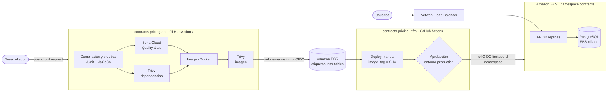

# Contracts & Pricing – Infraestructura y despliegue

Infraestructura como código y despliegue continuo de [contracts-pricing-api](https://github.com/migueflorez10/contracts-pricing-api) en **Amazon EKS (Kubernetes)**. Usa **Terraform**, **Docker**, **Kustomize** y **GitHub Actions**, con controles de seguridad y auditoría en cada paso.


## Flujo completo



## Estructura

```
contracts-pricing-infra
├── terraform/                 Infraestructura en AWS
│   ├── network.tf             VPC con subredes públicas y privadas, NAT y Flow Logs
│   ├── eks.tf                 Clúster EKS, nodos Spot, logs de auditoría y permisos del pipeline
│   ├── ecr.tf                 Registro de imágenes con etiquetas inmutables y escaneo
│   ├── github-oidc.tf         Roles que asume GitHub Actions sin llaves de acceso
│   └── budget.tf              Alerta de costos por correo
├── k8s/
│   ├── cluster/               Recursos que crea una sola vez el administrador
│   ├── base/                  Deployment, Service, ConfigMap, PostgreSQL, NetworkPolicies, PDB
│   └── overlays/
│       ├── local/             Despliegue local en kind
│       └── aws/               Despliegue en EKS con balanceador y disco gp3
└── .github/workflows/
    ├── validate.yml           Formato y validación de Terraform, esquema de Kubernetes, auditoría con Trivy
    └── deploy.yml             Despliegue con aprobación, verificación y rollback automático
```

## Controles de seguridad y auditoría

| Control | Cómo se implementa | Evidencia |
| --- | --- | --- |
| Segregación de funciones | El pipeline de la API solo puede publicar imágenes. El de infraestructura solo puede desplegar dentro del namespace `contracts`. El namespace y el almacenamiento los crea un administrador. | Políticas IAM en `github-oidc.tf` y permisos de acceso en `eks.tf` |
| Sin credenciales de larga duración | GitHub Actions se autentica en AWS con OIDC. Cada rol solo lo puede asumir un repositorio, una rama o un entorno específico. | No hay llaves de AWS en GitHub. CloudTrail registra cada `AssumeRoleWithWebIdentity` con el repositorio de origen. |
| Aprobación de cambios a producción | El despliegue usa el entorno `production` de GitHub, que exige la aprobación de un revisor. | Pestaña Deployments de GitHub: quién aprobó, cuándo y qué versión |
| Trazabilidad commit → imagen → despliegue | La etiqueta de la imagen es el SHA del commit y ECR no permite sobrescribirla. Cada despliegue registra la imagen, quién lo ejecutó y el enlace a la ejecución. | `kubectl rollout history`, etiquetas OCI de la imagen y resumen de cada ejecución |
| Calidad del código | Pruebas automáticas, cobertura con JaCoCo y Quality Gate de SonarCloud que bloquea el pipeline si no se cumple. | Panel de SonarCloud y reportes en los artefactos del pipeline |
| Gestión de vulnerabilidades | Trivy revisa dependencias, secretos e imagen, y bloquea la publicación si hay vulnerabilidades críticas con solución. ECR escanea cada imagen y Dependabot propone actualizaciones. | Pestaña Security de GitHub y escaneos de ECR |
| Configuración segura | Pods sin root, con sistema de archivos de solo lectura, sin capacidades extra y con Pod Security Standards en modo `restricted`. NetworkPolicies: solo la API llega a la base de datos. Discos EBS e imágenes cifrados. | Auditoría con Checkov y Trivy (ver abajo) |
| Registro y monitoreo | Logs de auditoría del plano de control de EKS y VPC Flow Logs en CloudWatch, más CloudTrail de la cuenta. | Grupos de logs en CloudWatch |
| Control de costos | Presupuesto mensual con alertas al 50 %, 80 % y 100 %. | AWS Budgets |
| Gestión de defectos | Plantillas de Issues para defectos e incidentes, plantilla de Pull Request y tablero en GitHub Projects. | Issues y Projects del repositorio |

### Resultado de la auditoría de configuración

Revisión con [Checkov](https://www.checkov.io/) sobre Terraform, los manifiestos renderizados, el Dockerfile y los workflows:

| Alcance | Aprobados | Fallidos | Excepciones documentadas |
| --- | --- | --- | --- |
| Terraform | 65 | 0 | 3 |
| Kubernetes (overlays local y aws) | 353 | 0 | 10 |
| Workflows y Dockerfile | 252 | 0 | 2 |

Cada excepción está justificada en el mismo archivo con un comentario `checkov:skip`:
- Los módulos de Terraform se fijan por versión del Registry y no por commit.
- PostgreSQL usa el UID 999 de la imagen oficial.
- Las imágenes se identifican por etiqueta inmutable y no por digest.
- La API recibe sus credenciales como variables de entorno inyectadas desde un Secret.
- En local la imagen no se descarga de un registro.
- La salud del contenedor la verifican las probes de Kubernetes.
- El despliegue recibe como parámetro una imagen ya construida.

---

## Opción 1: ejecutarlo gratis en tu computador (kind)

Requisitos: Docker Desktop (con al menos 4 GB de memoria), [kind](https://kind.sigs.k8s.io/) y kubectl.

```bash
# 1. Construir la imagen (desde la carpeta de contracts-pricing-api)
docker build -f deployment/Dockerfile -t contracts-pricing-api:local .

# 2. Crear el clúster y cargar la imagen (desde la carpeta de contracts-pricing-infra)
kind create cluster --name contracts
kind load docker-image contracts-pricing-api:local --name contracts

# 3. Desplegar
kubectl apply -f k8s/cluster/namespace.yaml
kubectl apply -k k8s/overlays/local
kubectl -n contracts get pods -w        # esperar a que los dos pods estén en Running (Ctrl+C para salir)

# 4. Abrir la API
kubectl -n contracts port-forward svc/contracts-pricing-api 8080:80
# http://localhost:8080/swagger-ui.html

# 5. Borrar todo al terminar
kind delete cluster --name contracts
```

## Opción 2: desplegar en AWS

> **Costo:** el entorno cuesta aproximadamente **USD 0,20 a 0,25 por hora** (unos USD 5 al día): plano de control de EKS, NAT Gateway, balanceador y dos nodos Spot. Si lo dejas encendido un mes, supera los USD 150. Levántalo para la demostración y destrúyelo al terminar (paso 7).

### Requisitos
- Cuenta de AWS con un usuario IAM administrador (no uses el usuario raíz)
- [AWS CLI v2](https://docs.aws.amazon.com/cli/latest/userguide/getting-started-install.html) configurado con `aws configure`
- [Terraform](https://developer.hashicorp.com/terraform/install) 1.6 o superior y kubectl

### 1. Crear la infraestructura

```bash
cd terraform
cp terraform.tfvars.example terraform.tfvars   # escribe tu correo para las alertas de costo
terraform init
terraform plan
terraform apply                                # tarda entre 15 y 20 minutos
```

Al terminar, Terraform muestra los valores que necesitas en los pasos siguientes. Para verlos de nuevo: `terraform output`.

### 2. Preparar el clúster (una sola vez, como administrador)

```bash
aws eks update-kubeconfig --region us-east-1 --name contracts-pricing-eks
kubectl apply -f ../k8s/cluster/namespace.yaml -f ../k8s/cluster/aws/storageclass-gp3.yaml
```

### 3. Configurar SonarCloud
1. Entra a [sonarcloud.io](https://sonarcloud.io) con tu cuenta de GitHub e importa la organización `migueflorez10`.
2. Analiza el repositorio `contracts-pricing-api`, elige el método **With GitHub Actions** y copia el token.
3. En **Administration → Analysis Method**, desactiva **Automatic Analysis**.

Si la organización o la llave del proyecto quedan con otro nombre, ajústalas en las propiedades `sonar.*` del `pom.xml` de la API.

### 4. Configurar GitHub

**Repositorio contracts-pricing-api** → Settings → Secrets and variables → Actions:

| Tipo | Nombre | Valor |
| --- | --- | --- |
| Variable | `AWS_REGION` | `us-east-1` |
| Variable | `AWS_ECR_ROLE_ARN` | salida `github_ecr_push_role_arn` |
| Secreto | `SONAR_TOKEN` | token de SonarCloud |

**Repositorio contracts-pricing-infra** → Settings → Environments → **New environment** llamado `production`:
- Activa **Required reviewers** y agrégate como revisor.
- En el mismo entorno, crea estas variables y secretos:

| Tipo | Nombre | Valor |
| --- | --- | --- |
| Variable | `AWS_REGION` | `us-east-1` |
| Variable | `EKS_CLUSTER_NAME` | salida `cluster_name` |
| Variable | `ECR_REPOSITORY_URL` | salida `ecr_repository_url` |
| Variable | `AWS_DEPLOY_ROLE_ARN` | salida `github_deploy_role_arn` |
| Secreto | `DB_USER` | usuario de la base de datos, por ejemplo `contracts` |
| Secreto | `DB_PASSWORD` | una contraseña segura |

### 5. Publicar la imagen
Haz un push a `main` en contracts-pricing-api (o ejecuta el workflow **CI/CD** desde la pestaña Actions). Si todo pasa, el resumen de la ejecución muestra la imagen publicada y su SHA.

### 6. Desplegar
En contracts-pricing-infra → Actions → **Deploy** → **Run workflow**, pega el SHA completo del commit y aprueba el despliegue cuando GitHub lo pida. Al terminar, el resumen muestra la URL pública de la API.

El pipeline verifica que la imagen exista en ECR, crea el Secret de la base de datos, aplica los manifiestos y espera a que la nueva versión esté sana. Si falla, vuelve automáticamente a la versión anterior.

### 7. Destruir el entorno

```bash
# Primero borra el namespace: elimina el balanceador y el disco que creó Kubernetes
kubectl delete namespace contracts

# Después borra la infraestructura
cd terraform
terraform destroy
```

Si `terraform destroy` se queda esperando la VPC, revisa en la consola de EC2 que el balanceador ya se haya borrado y vuelve a ejecutarlo.

## Gestión de defectos con GitHub Issues y Projects

1. En tu perfil de GitHub → **Projects** → **New project** → plantilla **Board** con las columnas Todo, In Progress y Done.
2. Vincula los dos repositorios al proyecto.
3. Registra defectos con la plantilla **Reporte de defecto** (API) o **Incidente** (infraestructura).
4. Cierra cada issue desde el Pull Request que lo corrige escribiendo `Closes #número`.

Para cerrar el ciclo de control de cambios, en **Settings → Branches** agrega una regla para `main` que exija Pull Request y que los checks del pipeline pasen antes de integrar.

## Autor

Miguel Ángel Martínez Flórez · [LinkedIn](https://www.linkedin.com/in/miguelmartinez-dataanalyst) · [GitHub](https://github.com/migueflorez10)
